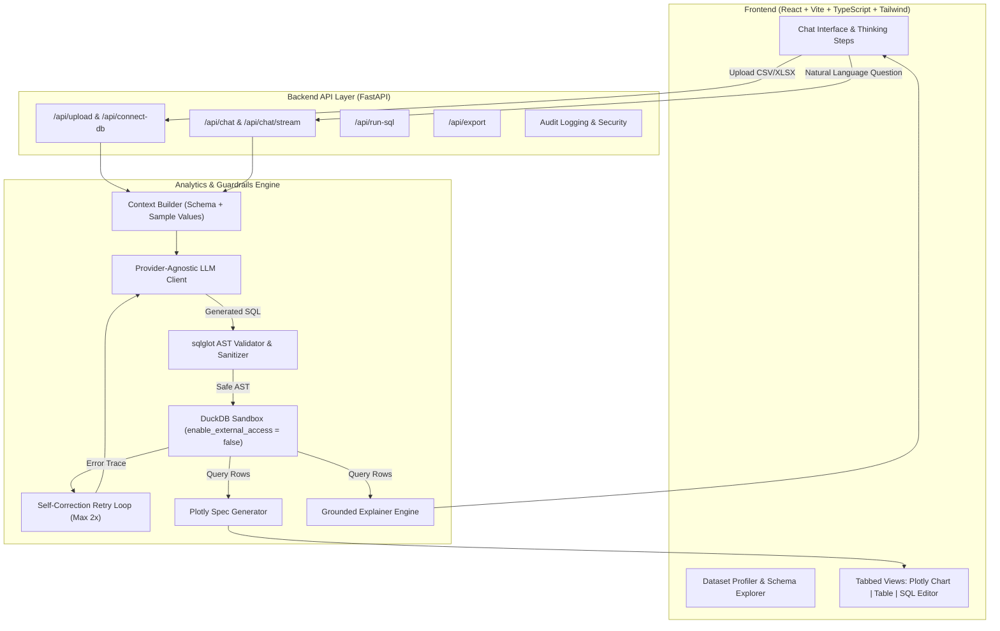

# AskData: Production-Grade AI Data Analyst

AskData is an enterprise-quality AI Data Analyst application that turns natural language questions into safe SQL, interactive Plotly visualizations, paginated data tables, and grounded natural language insights.

---

## 🌟 Key Features

- **Automated Ingestion & Profiling**: Upload CSV or Excel (`.xlsx`, `.xls`) files. Automatically infer schemas, calculate null rates, detect unique counts, evaluate min/max boundaries, and view sample rows.
- **Provider-Agnostic Text-to-SQL Pipeline**: Supports Google Gemini (default), OpenAI, Anthropic, or an offline Mock mode with zero external dependencies.
- **Defense-in-Depth SQL Validator**: Utilizes `sqlglot` AST parsing to enforce strict read-only execution (`SELECT`/`WITH` only), blocks DDL/DML, disables filesystem/network functions, checks table whitelists, and caps row limits.
- **Sandboxed Execution**: Isolated in-process DuckDB sessions with `enable_external_access = false`, memory caps, and hard query timeouts (10s).
- **Self-Correcting Error Loop**: If an LLM-generated query encounters a syntax or column error, the error trace is passed back to the model for automated correction (up to 2 retries).
- **Auto-Selected Visualizations**: Generates rich Plotly JSON specs dynamically (Bar, Line, Scatter, Pie, Histogram, Heatmap) with client-side PNG export.
- **Grounded Insights**: Explanations are strictly computed and grounded in returned dataset rows to eliminate hallucination.
- **Conversational Memory**: Multi-turn follow-up inquiries ("now break that down by region", "show only top 5") maintain context across questions.
- **Read-Only Database Connectors**: Connect external relational databases (PostgreSQL, MySQL, SQLite) with session-level read-only guarantees.
- **Exporting**: Download result tables as CSV, save Plotly charts as PNG, or export the entire session as a Markdown report.
- **Real-Time Thinking Steps**: Progress indicator detailing `Understanding -> Writing SQL -> Validating -> Running -> Charting -> Explaining`.

---

## 🏗️ Architecture



---

## 📊 Benchmark Evaluation Results

AskData includes an automated evaluation suite (`eval/run_eval.py`) that benchmarks 27 complex questions across two sample datasets (`sales_data` and `student_performance`):

| Evaluation Metric | Benchmark Result | Benchmark Target | Status |
| :--- | :--- | :--- | :--- |
| **Total Test Inquiries** | **27 queries** | 25+ | ✅ PASS |
| **Clean Execution Accuracy** | **100.0%** (27/27) | > 90% | ✅ PASS |
| **Average Pipeline Latency** | **7.9 ms** | < 500 ms | ✅ PASS |
| **AST Security False Positives** | **0%** | 0% | ✅ PASS |
| **Self-Correction Retries** | **0 retries** | <= 2 | ✅ PASS |
| **Failure Categories** | **0 failures** | 0 | ✅ PASS |

To reproduce the benchmark:
```bash
python eval/run_eval.py
```

---

## 🛡️ Security & Guardrails

AskData enforces five layers of security:

1. **AST AST-Level Validation (`sqlglot`)**: Only `SELECT` or `WITH ... SELECT` queries are permitted. Statements like `DROP`, `DELETE`, `INSERT`, `UPDATE`, `ALTER`, `TRUNCATE`, and `PRAGMA` are blocked at parse time.
2. **Function Blacklist**: Direct disk or URL scans (`read_csv`, `read_parquet`, `httpfs`, `system`) are rejected.
3. **DuckDB In-Process Sandbox**: Every session runs with `SET enable_external_access = false;`, preventing file/network operations even if an injection bypassed parsing.
4. **Row Caps & Timeouts**: Queries default to `LIMIT 500` (capped at 10,000 maximum) and execute with a 10-second thread timeout.
5. **Prompt Injection Mitigation**: Sample cell values used for context enrichment are escaped and treated purely as data literals, never executable instructions.

---

## 🚀 Quickstart Guide

### Option 1: Docker (One-Command Startup)

```bash
# 1. Clone repository and copy environment configuration
cp .env.example .env

# 2. Build and start containers
docker-compose up --build
```
- Frontend UI: `http://localhost:5173` (or `http://localhost`)
- Backend API Docs: `http://localhost:8000/docs`
- Health Check: `http://localhost:8000/health`

---

### Option 2: Local Development

#### 1. Backend Setup (Python 3.11+)
```bash
# Create and activate virtual environment
python -m venv venv
.\venv\Scripts\activate   # Windows
# source venv/bin/activate  # macOS/Linux

# Install dependencies
pip install -r backend/requirements.txt

# Configure environment variables
cp .env.example .env

# Run backend test suite (38 unit & integration tests)
pytest

# Start FastAPI server
uvicorn app.main:app --reload --port 8000 --app-dir backend
```

#### 2. Frontend Setup (Node 18+)
```bash
cd frontend

# Install dependencies
npm install

# Run Vitest smoke tests
npm test

# Build for production
npm run build

# Start Vite development server
npm run dev
```

---

## 💡 Example Questions

AskData comes pre-packaged with 2 sample datasets in `sample_data/`:

### 1. Retail Sales Dataset (`sales_data.csv` / `.xlsx`)
- *"What is the total sales and profit by region?"*
- *"Which product categories generate the highest revenue?"*
- *"Who are the top 5 customers by sales?"*
- *"Show the monthly sales trend over time."*
- *"Which orders received a discount higher than 10%?"*

### 2. Student Performance Dataset (`student_performance.csv` / `.xlsx`)
- *"What is the average GPA by academic department?"*
- *"What is the pass rate across different majors?"*
- *"Who are the top 5 students by final score?"*
- *"Is there a correlation between study hours and final exam score?"*
- *"Compare attendance rates between passing and failing students."*

---

## 📁 Repository Structure

```
AskData/
├── backend/
│   ├── app/
│   │   ├── api/            # FastAPI route controllers (/upload, /chat, /run-sql, /export, /connect-db)
│   │   ├── core/           # DuckDB engine, sqlglot validator, DB connectors, security
│   │   ├── models/         # Pydantic v2 schemas and session models
│   │   ├── services/       # Profiler, context builder, LLM client, SQL agent, Plotly generator, explainer
│   │   ├── config.py       # Pydantic Settings
│   │   └── main.py         # App entrypoint, CORS, audit logging middleware
│   ├── tests/              # 38 pytest test cases (validator, profiler, engine, pipeline, exports)
│   └── requirements.txt
│
├── frontend/
│   ├── src/
│   │   ├── components/     # Layout, Sidebar, Chat, PlotlyChart, ResultTable, SqlEditor, Modals
│   │   ├── api/            # API client wrapper
│   │   ├── types/          # TypeScript definitions
│   │   └── tests/          # Vitest smoke tests
│   ├── package.json
│   ├── vite.config.ts
│   └── tailwind.config.js
│
├── sample_data/
│   ├── sales_data.csv & .xlsx
│   └── student_performance.csv & .xlsx
│
├── eval/
│   ├── eval_dataset.json   # 27 benchmark question/expected-SQL pairs
│   ├── run_eval.py         # Evaluation benchmark runner
│   └── eval_results.json   # Benchmark execution summary
│
├── docs/
│   ├── ARCHITECTURE.md     # System design & pipeline stages
│   └── SECURITY.md         # Threat model & AST guardrails
│
├── Dockerfile.backend
├── Dockerfile.frontend
├── docker-compose.yml
└── README.md
```

---

## 🔮 Known Limitations & Roadmap

- **Multi-Table Joins on Upload**: Currently, each uploaded spreadsheet maps to an isolated table per session. Future work includes multi-tab Excel ingestion with foreign-key relationship auto-detection.
- **Direct Voice Queries**: Adding browser speech-to-text input for hands-free analysis.
- **Subprocess Sandbox for Python/Pandas**: An optional sandbox runner for executing raw Pandas expressions in an isolated container.

---

## 📄 License
MIT License. Built for high-reliability data analysis and portfolio demonstration.
